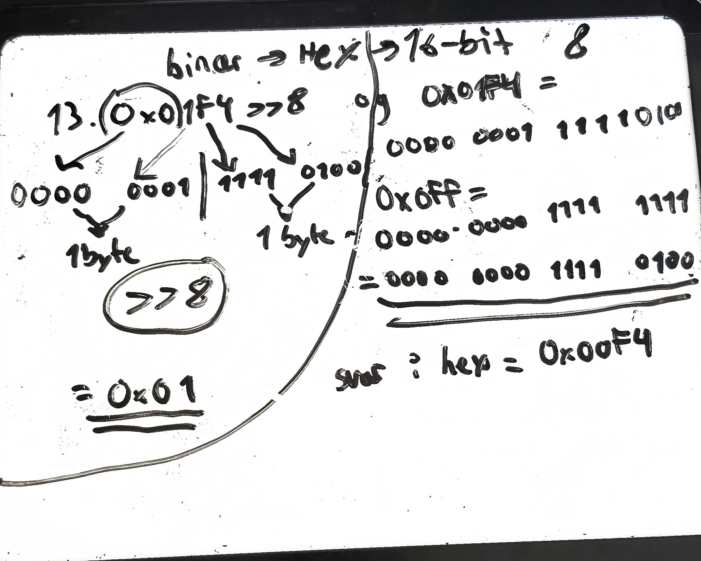
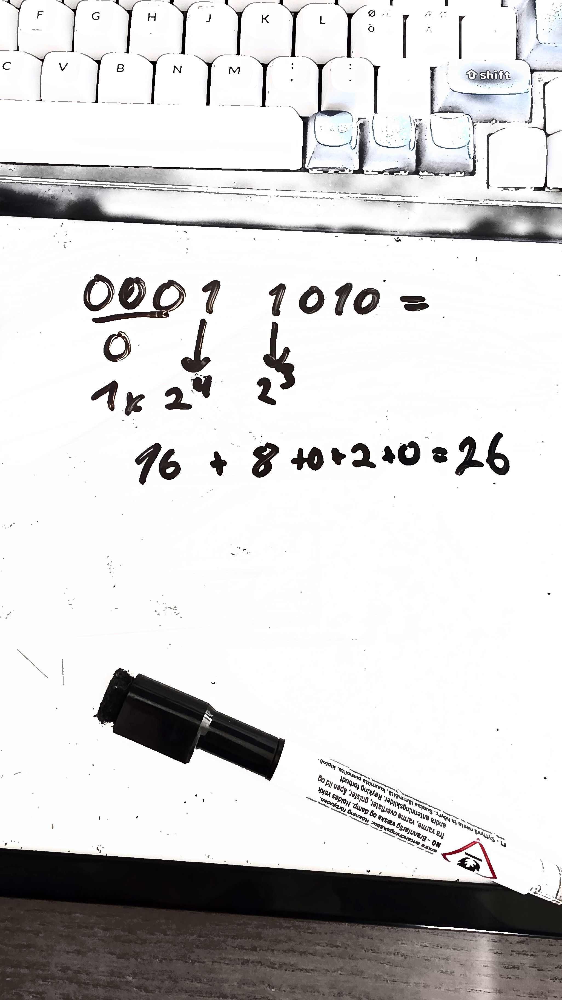
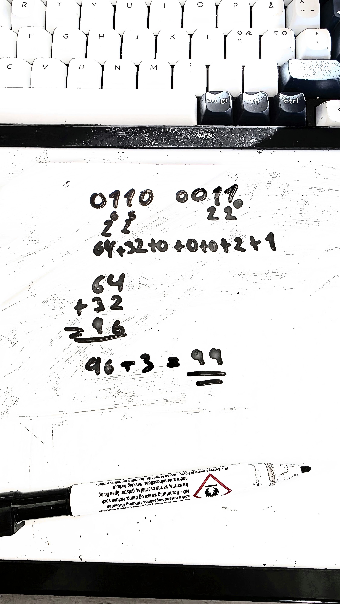
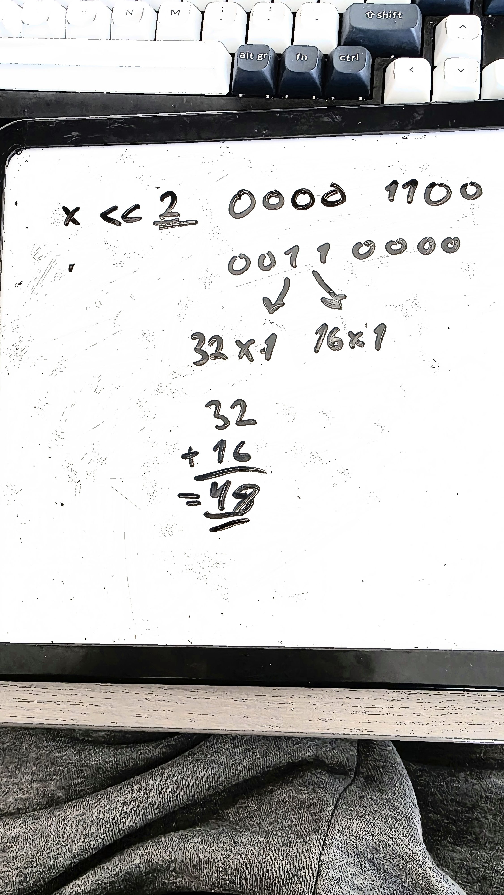
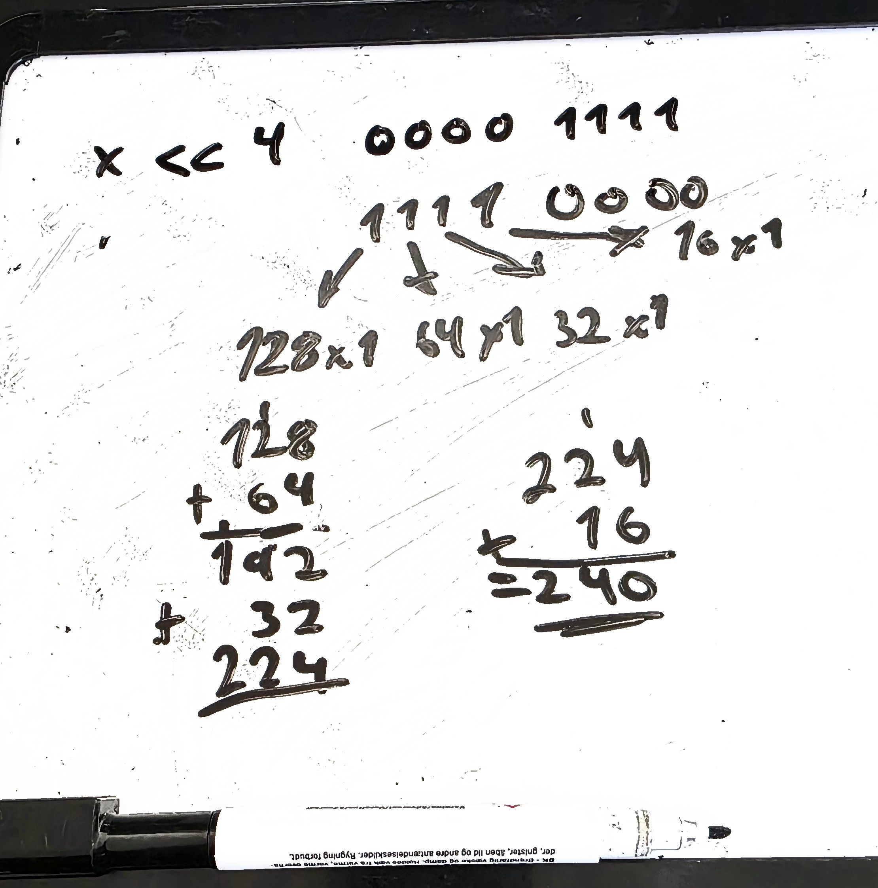
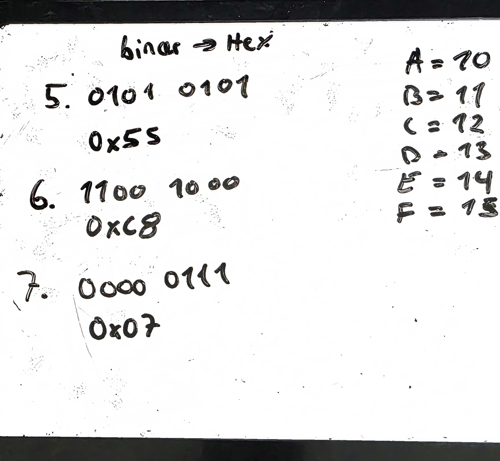
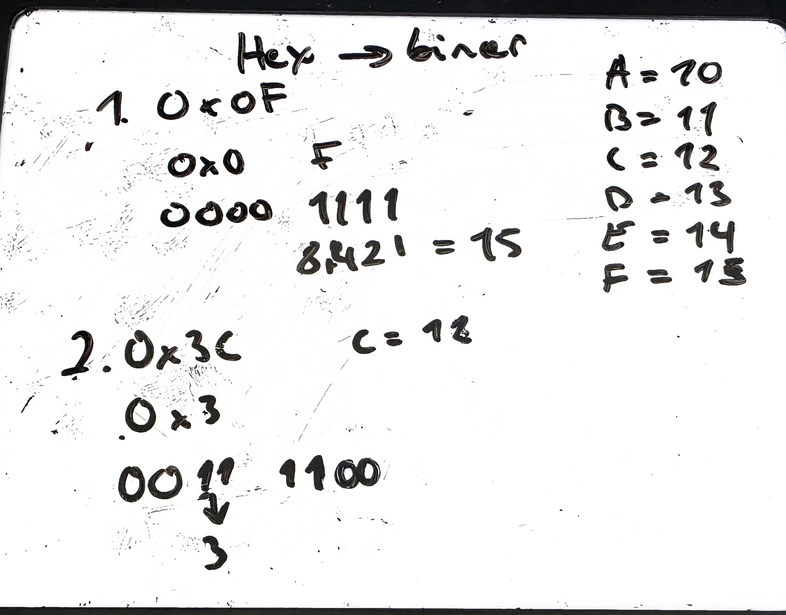
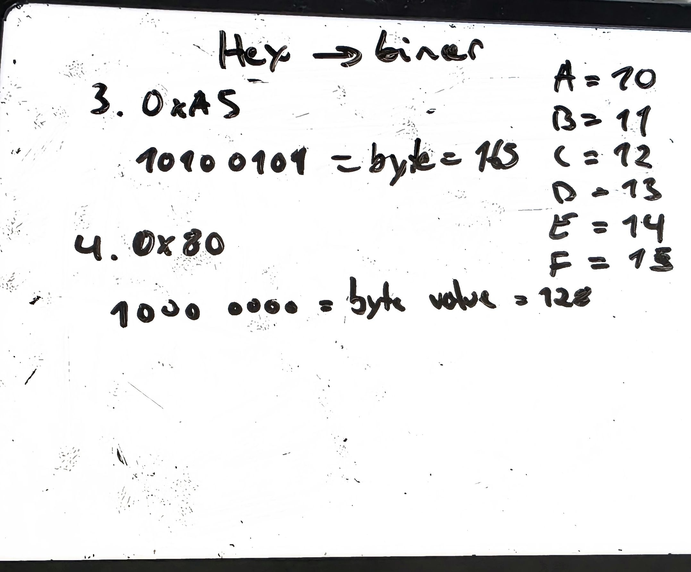
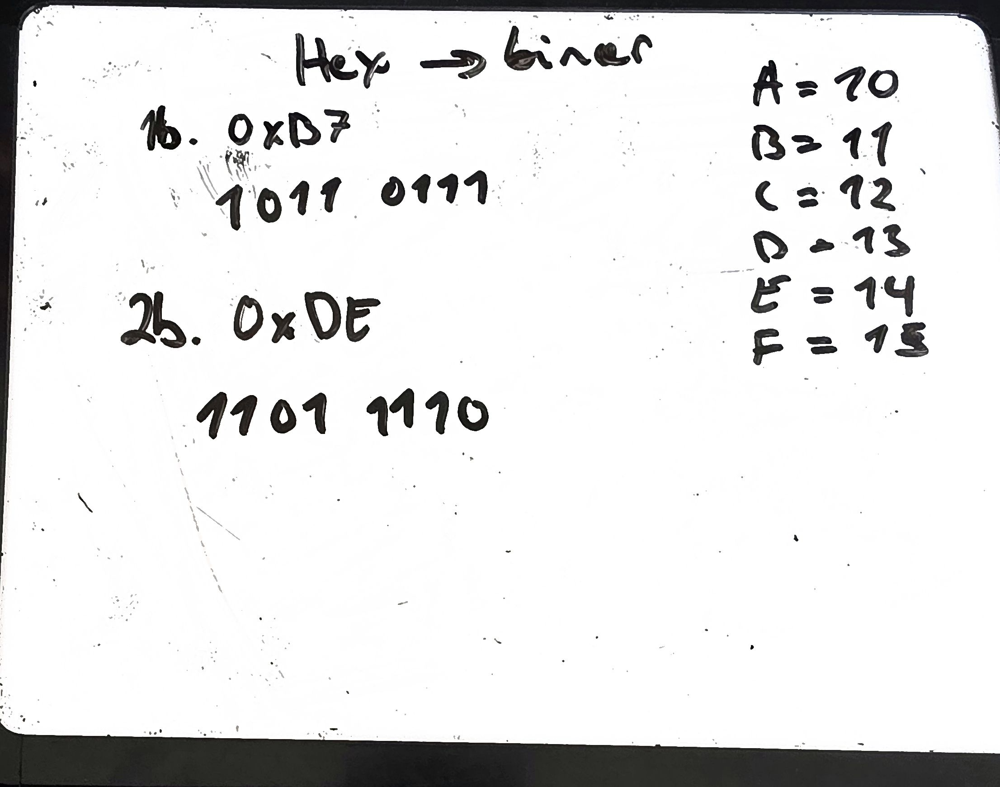

 # Bit wise operators & calculating binaries

 So i have lately been working with learning how to manipulate bits, and also to understand what each byte actual represent.
 I think this is crucial, because this is understand data in bits and also how they will be represented in the memory and also through the network.

So i wrote the `operators.c` [bitwisefile](../../bitwiseOperators/operators.c) to understand how this work in programming.
Most of time that went to this, was actually on a whiteboard calculating from binary->hex and hex->binary, and also using operators on them.

This was really neccessary to learn, and i think learning this will help me a lot in the future.
There are some photos here also that shows how i calculated and how i solved the tasks.

## Why I'm learning this

I'm planning to build a Modbus TCP client in C in the future.
Modbus registers are 16-bit values, but the network only sees a stream of bytes. So every value has to be split into a high byte and a low byte (high byte first) before it is sent, and put back together on the other side. To do that, I need the bitwise operators.

For example, `0x01F4` = `0000 0001 1111 0100`:
- `0x01F4 >> 8` gives the high byte `0x01`
- `0x01F4 & 0xFF` gives the low byte `0xF4`

The first photo, was a really difficult one - but it felt great to solve it.

Thank you for your time and I hope that you enjoyed this document and the problem solving.
Have a nice day! :D

 